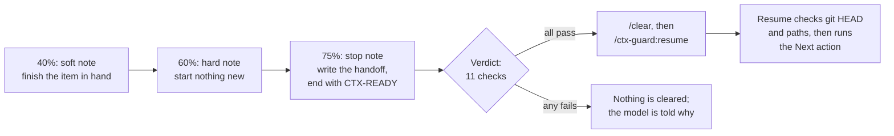

# ctx-guard

**Autopilot with brakes for long Claude Code sessions.**

ctx-guard watches your context window and your 5-hour and weekly usage limits, and turns
thresholds into actions. It tells the model when to wrap up, brakes subagents and web tools
before a limit runs out, caps each subagent's context, and restarts the session from a handoff
only when 11 checks say your work is safe. One JSON file, no code.

[](LICENSE)


```text
main · 312k (31%) · 5h 42% (2h10m) · wk 61% (3d4h)
```


<sub>Demo config: thresholds lowered so the cycle fits in about two minutes; sped up 5×.</sub>

```text
/plugin marketplace add svd/agent-skills
/plugin install ctx-guard@svd-agent-skills
```

## Why

Long Claude Code sessions go wrong in three ways:

- **Auto-compact forgets what mattered.** It fires late, in the middle of a turn, and its
  summary can drop the decisions and corrections you made along the way
  ([anthropics/claude-code#36068](https://github.com/anthropics/claude-code/issues/36068)).
- **Subagents eat the week.** In one month-long log study, subagents took 48% of all tokens
  ([dev.to](https://dev.to/aidiveyt/the-september-cut-took-17-of-my-claude-code-week-subagents-were-taking-48-98n)).
  You find out when the weekly window is gone on Wednesday.
- **Restarting is either manual or blind.** Watching the meter and typing `/clear` yourself
  breaks your flow; a `/clear` while a subagent runs, or with work not yet committed, loses work
  you already paid for.

## What it does

| See | Steer | Restart safely |
|---|---|---|
| A **band** above the prompt with context fill, a prompt-cache countdown, both usage windows and their resets, plus your own project probes (branch, worktrees, plan progress). | **Triggers** on context, usage, time to reset, cost, idle time and the prompt cache send the model `soft` → `hard` → `stop` notes, show toasts and OS notifications, **deny tools** such as `Agent`, `WebFetch` or browser navigation while a window runs hot, and cap each **subagent's** tokens by type. | The model rewrites a **handoff** and ends its reply with `CTX-READY`. ctx-guard runs an 11-check **verdict**; if every check passes it runs `/clear` and resumes from the handoff, which is checked against the repo first. Prefer `/compact`? One setting. |

A note, as the model sees it:

> [ctx-guard] Context is at 400k (40% of 1M), past 40%. Plan for a handoff: finish the item in
> hand and keep new work small. At the next safe point — no subagents running, current work
> recorded — write the handoff to `.ctx-guard/main-handoff.md`: Rewrite the whole file.
> Sections: Goal, State, Next action. Then tell the operator 'ready for /clear'.

Each note also shows a toast, so you see what the model was told (`noteToasts`).

The prompt cache gets the same treatment. The band counts down to the cache's expiry
(`cache 8m`), and a `cache.miss` trigger, such as the presets' `cache-miss` toast, flags a request
that re-wrote a cache that should have been warm.
Keeping the cache warm while you are away is opt-in: a trigger's `ping` action sends a tool-less
request that refreshes the cache, and its `prompt` action submits a turn that asks the model for
a handoff. Both are capped by `times` and need `/ctx-guard trust`.

A brake can also say what happens when it **lifts**. A trigger's `lift` tells the model the
tools are back, notifies you, or wakes an idle session that stopped because of the brake. Before
a wake, ctx-guard reads fresh usage with one request over the session's context, so a window that
other sessions filled meanwhile wakes nothing. Waking is opt-in, capped by `lift.times`, needs
`/ctx-guard trust`, and spends usage on that request and on the woken turn.

## How a restart works



The verdict refuses a restart when the repo's automatic settings are not approved; a restart,
compact or resume is already under way; context is below the role's minimum; this session
restarted too recently; the resume command is missing; a subagent, workflow or background shell
is running; another live session holds the role; the handoff is missing, empty or stale; a peer
role restarted recently or wins a simultaneous restart; or any of your own ready checks (say,
"the worktree is clean") fails. Details: [Handoff, restart and compact](docs/handoff-and-restart.md).

## Quick start

1. **Install** (above) and start a new session. The band appears after the first response.
   Nothing else changes: with no config ctx-guard only draws the band and shows toasts at
   50 / 70 / 85 % context and 80 / 90 % of either usage window. It sends the model nothing,
   blocks nothing and runs nothing on its own.
2. **Turn on notes.** Open `/config`, find ctx-guard, set **Default role** to `main`. Every
   interactive session now gets the built-in ladder: notes at 40 / 60 / 75 % context, notes as
   the usage windows fill, and `Agent` and `Workflow` blocked when the week fills early or a
   window passes 95 % (web tools too, at 95 %). Restarts stay manual: the model writes a
   handoff and tells you "ready for /clear".
3. **Go automatic in a repo.**

   ```text
   /ctx-guard init      # writes .claude/ctx-guard.json (the solo preset) and .gitignore lines
   /ctx-guard trust     # approves automatic restarts for this repo
   /ctx-guard check     # dry run of the restart verdict, check by check
   ```

   Review and commit `.claude/ctx-guard.json`: it is the team file.

Type `/ctx-guard` any time for a report: role, config and its errors, live figures, fired
triggers, active blocks and trust. Type `/ctx-guard:clear` to have the session write its handoff
and restart now, before any note asks for it. Full walk-through: [Getting started](docs/getting-started.md).

## Safety by design

- **Restarts fail closed.** Any failed check refuses the restart, and nothing is cleared.
- **Nothing runs unattended without your approval.** Automatic restarts, `compact`, `ping` and
  `prompt` actions, a lift's `prompt`, ready checks and band probes need `/ctx-guard trust` per
  repo. Trust covers the exact settings and the scripts' contents; any change withdraws it until you
  approve again.
- **The model cannot talk its way out.** `role`, `check`, `trust`, `pause` and `init` work only
  when you type them; ctx-guard refuses them from the model or another plugin.
- **Blocks fail open and lift themselves.** An unknown metric or a failed check denies nothing,
  and a deny lifts once its condition stops holding (a window resets, the reset gets close).
- **ctx-guard never writes your handoff.** The model writes it with the whole conversation in
  view; the resume checks the recorded `HEAD` is `HEAD` or an ancestor and that every named path
  exists, and stops to ask you on any mismatch.
- **Easy to turn down.** `/ctx-guard pause 1h`, or the `blocking`, `autoActions` and `enabled`
  switches in `/config`.

## What it runs, reads, writes and sends

ctx-guard makes no network requests of its own, has no telemetry and fetches nothing. The requests
it can start are model requests that Claude Code sends like any other: a keep-warm `ping`, a
`prompt` turn, a lift's check and wake turn, and the turns that follow its `/clear` and `/compact`
(see Sends to the model). Every figure comes from Claude Code itself or from files in your project.

- **Reads.** Claude Code's own figures for the session through the mod API: context fill, token
  usage, the 5-hour and weekly limit status, running agents and background tasks. Your Claude
  Code settings, for `autoCompactWindow` only. The `CTX_GUARD_ROLE`, `HOME` and
  `CLAUDE_CONFIG_DIR` environment variables. From the conversation it takes only figures: each
  model request's token usage, the length of each tool result (to estimate the fill before the
  usage arrives) and whether the model's last reply ends with the ready token. It keeps no
  conversation text and hands none to any script. With `cache.ttl` at `auto`, the session
  transcript, `~/.claude/projects/<working directory>/<session id>.jsonl` (under
  `CLAUDE_CONFIG_DIR` when set): it searches the file for the cache-write figures that tell a
  5-minute cache from a 1-hour one, and keeps nothing else from it. Its config,
  `.claude/ctx-guard.json` and `.claude/ctx-guard.local.json`. A role's handoff file when it
  resumes. The ready-check and probe scripts your config names, to hash them for trust.
- **Writes.** Role leases (`<role>.owner`) and restart stamps in the project's state folder,
  `.ctx-guard/` by default (`stateDir`). Its session state and your trust approvals go to Claude
  Code's own plugin storage. Only `/ctx-guard init`, when you type it, writes a file outside
  that folder: it creates `.claude/ctx-guard.json` from a preset if there is none and adds the
  local config and the state folder to `.gitignore`. Handoffs are written by the model, not by
  ctx-guard.
- **Sends to the model.** Notes that start with `[ctx-guard]`, added to the conversation as
  user messages: to the main session when a trigger fires or a brake lifts, or to a subagent
  nearing its budget.
  Two more things reach the model, both only after `/ctx-guard trust`, with `autoActions` on and
  a `times` cap: a `ping`, one tool-less request (`Reply with OK.`) over the session's own
  transcript, made with the engine's `$.model.fork`, whose reply is discarded; and a `prompt`, a
  real turn submitted with the trigger's `message`, or by default a message that starts with
  `[ctx-guard]`. A trigger whose `lift.do` holds `prompt` does both when its brake lets go while
  the session is idle: first the same tool-less request, to read the account's current usage
  limits, then, if its tools are still free, a turn asking the model to check where the work
  stands and carry on. Both spend usage; the turn is capped by `lift.times`.
- **Runs commands.** Three, and only with `autoActions` on and after `/ctx-guard trust`:
  - `/clear`, when the model ends a reply with the ready token after a context note asked for a
    restart, the role restarts by clear, and every check of the verdict passes;
  - right after that `/clear`, once: `/ctx-guard:resume role=… handoff=…`, or the restart
    command the role names in your config, so the fresh session picks up from the handoff;
  - `/compact`, with the instructions from your config, when a trigger with the `compact` action
    fires or a role that restarts by compact sends the ready token. It waits for the turn to end.

  It also adds the `/ctx-guard` command; its `role`, `check`, `trust`, `pause` and `init` work
  only when you type them.
- **Runs programs.** Only the commands you write in your project config: each ready check in a
  role's `restart.readyChecks` and each probe in `band.probes`, given as an argument list in its
  `run` field (`["sh", ".claude/ctx-guard/clean-worktree.sh"]`) and started as written, with no
  shell. Why: a ready check is your own test that the work is safe to restart (say, the worktree
  is committed), and a restart waits until every check exits 0; a probe adds a figure of your
  project (branch, worktrees, plan progress) to the band. They run from the project root, with a
  timeout, and only after `/ctx-guard trust`; ctx-guard has no command of its own to start.
  ctx-guard hands them no file contents, only `CTX_GUARD_*` environment variables: the role, the
  project root, the state folder, the handoff path and its modification time, the restart mode,
  why the script runs and when the session started. It reads back the exit code and the output:
  a probe's output becomes band text, a failed check's output explains the refusal. These
  scripts are the only way anything leaves ctx-guard, and what they do is yours to write. The
  scripts in `skills/guide/assets/` are examples to copy; none runs unless your config names it.
  The `superpowers-plan.py` probe reads plan files written by the
  [superpowers](https://github.com/obra/superpowers) plugin.
- **Shows.** The band above the prompt (or status-line text), toasts, and OS notifications
  through `$.ui.notify`, Claude Code's own notification call; no other plugin is involved.

What each hook does, and what it may change:

| Hook | What it does |
| --- | --- |
| `session.start`, `session.measure`, `session.end`, `turn.start`, `turn.step`, `turn.complete`, `classic.Stop` | Read the figures and evaluate the triggers. A main-loop `turn.step` also records, for lifts, that the model read a brake's note: a touch. Each passes the event on unchanged. |
| `prompt.submit` | Notes whether the prompt is ctx-guard's own `prompt` action, to tell its turn from yours, and whether it is your own input (by its origin), which stops a lift from waking the session. Passes the prompt on unchanged. |
| `tool.call` | Denies a main-loop tool call while a `deny` trigger holds, and a subagent's call once it is past its budget. For lifts, it records a refused call as a touch of the brakes on that tool, and a call of a freed tool drops that lift's wake prompt. Every other call passes unchanged. |
| `agent.spawn` | Records each new agent's id and type, for its budget. Passes the spawn on unchanged. |
| `command.run` | Runs `/ctx-guard`. For `/ctx-guard:resume` typed by you, checks its `role=` claim against the role lease, refuses it if another session holds the role, and fills in the role, handoff path and prompt it already knows. For a role's restart command typed by you, refuses it if another session holds the role. For `/ctx-guard:clear` typed by you, hands the model your role's restart note as the command's text; from anyone else, refuses it. Notes that a command you typed is your own input, for lifts. Every other command passes unchanged. |
| `ui.render` (`AbovePrompt`) | Draws the band. |

## Pick your setup

| You want | Start from |
|---|---|
| Just the figures, nothing else | [1. Just watch the figures](docs/use-cases.md#1-just-watch-the-figures) |
| Notes, but you decide when to clear | [2. Notes with manual restarts](docs/use-cases.md#2-notes-with-manual-restarts) |
| One long session that restarts itself | [3. Solo session with automatic clear and resume](docs/use-cases.md#3-solo-session-with-automatic-clear-and-resume) |
| Never clear with uncommitted work | [4. Never clear with uncommitted work](docs/use-cases.md#4-never-clear-with-uncommitted-work) |
| `/compact` instead of `/clear` | [5. Compact instead of clear](docs/use-cases.md#5-compact-instead-of-clear) |
| A coordinator with subagent budgets | [6. Coordinator and workers](docs/use-cases.md#6-coordinator-and-workers) |
| Two sessions, lead and reviewer | [7. Peer sessions](docs/use-cases.md#7-peer-sessions) |
| Make the weekly limit last | [8. Usage-limit brake](docs/use-cases.md#8-usage-limit-brake), [9. Early-spend brake](docs/use-cases.md#9-early-spend-brake) |
| Keep the prompt cache warm while you are away | [18. Stepped away](docs/use-cases.md#18-stepped-away) |
| Builders in git worktrees | [13. Builders in git worktrees](docs/use-cases.md#13-builders-in-git-worktrees) |

All 18 recipes: [Use cases](docs/use-cases.md).

## How it compares

| Kind of tool | Examples | What ctx-guard adds |
|---|---|---|
| Usage monitors and status lines | ccusage, Claude-Code-Usage-Monitor, ccstatusline, claude-hud | They show the figures; ctx-guard acts on them. Keep using them side by side. |
| Handoff and clear-resume plugins | ctx-handoff-mod, claude-code-auto-handoff, clear-resume, claude-handoff | Usage-limit brakes, subagent budgets, multi-session roles and a fail-closed restart verdict with your own checks. |
| Built-in auto-compact | Claude Code | A restart at a safe point, from a handoff you can read and the resume verifies, instead of a mid-turn summary. |

The full feature matrix, including where other tools do better: [Comparison](docs/comparison.md).

## Requirements and limitations

- **Claude Code 2.1.293 or later.** On an older version ctx-guard shows a toast at session start
  and some checks may not work.
- **A mod.** ctx-guard is a TypeScript hooks module that Claude Code loads in-process: nothing to
  build, no `npm install`. Mods are a new plugin kind, and their API may still change.
- **Interactive sessions.** `claude -p` runs get no role, so they only see the band and toasts.
- **Claude Code only.** It does not watch Codex, Cursor or other agents.
- **Restarts need the model's cooperation** to write the handoff and send the token. For a
  backstop that needs none, a trigger can run `compact` on its own.
- **The cache TTL can be a guess.** ctx-guard reads it from the transcript when it can and
  otherwise guesses; the band marks a guess with `~`, and `cache.ttl` fixes it. Each `ping` reads
  the whole prefix at the cache-read rate, and `times` caps how many.

## FAQ

**Does it cost tokens?** The band and toasts cost none. Notes are a few lines each, sent once
when a threshold is crossed (or every step past it, with `every`).

**Can the model restart the session on its own?** Only after a context note asked for it, with
a fresh handoff on disk and every check passing. The token inside a sentence, or from a subagent,
never counts.

**Will it clear while a subagent is running?** No. The verdict refuses with `agents-running`.

**Does it work with superpowers or session-handoff?** Yes. A band probe shows a superpowers
plan's progress, and any skill can write the handoff
([recipe 11](docs/use-cases.md#11-handoffs-through-the-session-handoff-skill),
[recipe 15](docs/use-cases.md#15-a-superpowers-plans-progress-on-the-band)).

**Something does not work.** Run `/ctx-guard`, then `/ctx-guard check`, then see
[Troubleshooting](docs/troubleshooting.md).

## Documentation

| Doc | What is in it |
|---|---|
| [Getting started](docs/getting-started.md) | Concepts, install, the built-in ladder, the first project config, trust. |
| [Configuration](docs/configuration.md) | Layers and switches, quantities, triggers, what to block, roles, commands. |
| [Handoff, restart and compact](docs/handoff-and-restart.md) | Restart modes, the handoff file, the ready token, the verdict, compact. |
| [Use cases](docs/use-cases.md) | 18 complete configs, from watch-only to worktree builders. |
| [Troubleshooting](docs/troubleshooting.md) | Symptoms, refusal codes and fixes; files ctx-guard writes. |
| [Comparison](docs/comparison.md) | ctx-guard next to monitors, handoff plugins and built-ins. |
| [Config reference](skills/guide/references/config-reference.md) | Every key, default, refusal code and trust rule. |
| [JSON Schema](skills/guide/assets/ctx-guard.schema.json) | For editor completion: point `$schema` at it. |
| [CHANGELOG](CHANGELOG.md) | What changed, release by release. |

## License

MIT, see [LICENSE](LICENSE).
